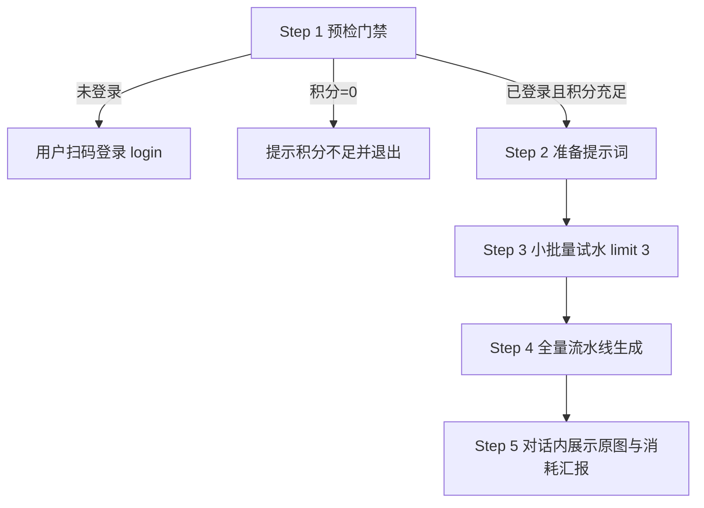

# 即梦 AI 批量生图 (Jimeng Batch Image)

把一批中文提示词自动转化为高质量图片。底层通过 Playwright 驱动本机 Microsoft Edge 浏览器，复用已登录的持久化 Profile，所有请求均在页面真实上下文中调度完成（由即梦前端引擎自动生成合规的 `a_bogus` 与 `msToken` 请求签名），**无需任何第三方 API key**。

> [!NOTE]
> 纯 HTTP 直连会被即梦服务端 Shark 风控系统拦截（报错 `ret=1019 shark not pass`），切勿尝试脱离浏览器直接发包。

---

## 0. 极速上手（Cheatsheet）

**工作目录：**
```powershell
cd "C:\Users\Lizhuo\Desktop\即梦AI\jimeng-batch"
```

**三步极速流：**
```powershell
# 1. 预检真实积分与登录态（无头、零成本）
python cli.py credit

# 2. 试水跑 3 条验证画质与提示词契合度
python cli.py run ..\prompts.txt --limit 3 --headless --pipeline 3

# 3. 确认满意后全量批处理
python cli.py run ..\prompts.txt --headless --pipeline 4
```

> [!TIP]
> 核心脚本已内置 UTF-8 输出重定向，在 Windows PowerShell 或 CMD 下直接输入 `python cli.py ...` 即可原生输出中文，无需添加任何前缀。

---

## 1. 默认锁定档位（极速省心，切勿追问）

| 参数项 | 默认锁定值 | 设计依据与说明 |
|---|---|---|
| **模型** | `Seedream 4.7` | 实测画质优秀且性价比最高，仅 **1 积分/张** |
| **分辨率** | `2K` | 与 4.7 模型搭配为最低价格档（4K 为 2 积分） |
| **画幅比例** | `智能比例` | 用户指定默认档。⚠️ 已知限制：该档由服务端按提示词自己算构图，**尺寸不稳定**（实测既出过 2048×2048 也出过 2304×1728）。要确定尺寸必须显式传 `--ratio` |
| **生成张数** | `1` | 每条提示词生成 1 张。要多条请显式传 `--count N`（1~8） |

按当前平台赠送额度（约 66~72 积分/日），默认档位下约可生成 66~72 条。**当用户未指定特殊参数时，一律默认采用此套配置，不要向用户多余追问。**

### ⚠️ 关于「智能比例」的已知限制（必须如实告知用户）

默认档位用 `智能比例`。这一档**由服务端按提示词自己算构图，尺寸不稳定** —— 实测既出现过 2048×2048 方图，也出现过 2304×1728。

零成本对照实验（用 `page.route` 拦截 `/mweb/v1/aigc_draft/generate` 后 `abort()`，不扣积分）拿到完整枚举：

| UI 比例 | 请求体 `image_ratio` | `intelligent_ratio` | `large_image_info` |
|---|---|---|---|
| **智能** | **字段不存在** | `true` | 2048×2048 |
| 1:1 | 1 | false | 2048×2048 |
| 3:4 | 2 | false | 1728×2304 |
| 16:9 | 3 | false | 2560×1440 |
| 4:3 | 4 | false | 2304×1728 |
| 9:16 | 5 | false | 1440×2560 |
| 2:3 | 6 | false | 1664×2496 |
| 3:2 | 7 | false | 2496×1664 |
| 21:9 | 8 | false | 3024×1296 |

**处理原则：**
- 用户没提比例 → 用默认 `智能比例`，**但若用户对画幅有要求（"要横图/竖图/壁纸/海报"），必须显式传 `--ratio`**。
- **不要在用户没问的情况下主动劝阻**；但若用户表达了困惑（"怎么都是方图"），直接指出这是平台行为，并给出替代档位建议。

三条硬结论：

1. **「智能比例」尺寸不稳定**：服务端逐条算构图，同一批里不同提示词可能得到不同比例。要确定画幅必须显式传 `--ratio`。
2. **真正决定出图尺寸的是 `large_image_info.width/height`，不是 `image_ratio`**。`image_ratio` 只是配套标记；只改它而让宽高停在 2048×2048，出图必然还是方图。
3. 比例枚举值有陷阱：`16:9 = 3`、`4:3 = 4`。**这两个极易写反**，本项目历史上就写反过，导致选 4:3 出横版 2560×1440。改动 `RATIO_KEYS` 必须对照上表核对。

---

## 2. 五步标准执行流（SOP）



### Step 1 · 预检门禁（强制前置）

在执行批量任务前，必须先执行快速预检：
```powershell
python cli.py credit
```
- 输出形如：`[cli] 积分：剩余 24，还能生成约 24 条；单价 1/张 × 1张 = 1/条`。
- 若返回未登录（退出码 3），则执行环境登录指令，让用户本人在弹出的窗口中扫码：
  ```powershell
  python cli.py login
  ```
  *(登录态基于 `sid_guard`，有效期约 60 天，无需每次登录)*
- 也可直接运行环境自检：
  ```powershell
  python cli.py doctor
  ```

### Step 2 · 准备提示词

提示词文本格式为一行一条，空行与以 `#` 开头的注释行将自动跳过：
- 若用户直接提供了提示词文件，直接使用该文件路径。
- 若用户在对话中给出了多句描述，在 `C:\Users\Lizhuo\Desktop\即梦AI\` 目录下写入 `prompts.txt`。
- 单条临时测试可直接通过 `-p` 传参：
  ```powershell
  python cli.py run -p "一只可爱的橘猫趴在窗台看雨，治愈系插画" --headless
  ```

### Step 3 · 试水验证与批量生成

**首批批量任务必须强制先用 `--limit 3` 试水跑前 2~3 条**，确认出图效果符合用户预期，再放开全量。用户明确指示“直接全量”时除外。

```powershell
# 试水运行
python cli.py run ..\prompts.txt --limit 3 --headless --pipeline 3

# 全量流水线生成
python cli.py run ..\prompts.txt --headless --pipeline 4
```

### Step 4 · 输出目录与落盘定位

- 图片默认保存在：`C:\Users\Lizhuo\Desktop\即梦AI\data\outputs\<批次时间戳>\`
- 时间戳格式为 `YYYYMMDD-HHMMSS`。任务结束后控制台将直接打印完成统计与输出路径：
  ```text
  完成：成功 12 条，失败 0 条，耗时 103.2s
  输出目录: C:\Users\Lizhuo\Desktop\即梦AI\data\outputs\20261030-062500
  ```

### Step 5 · 必须在对话内图文展示（核心交互铁律）

**生图完成后，严禁只报文件路径！必须把生成的图片渲染进对话回复中让用户直接看见。**

1. **真实文件名扫描**：
   由于图床扩展名可能从 `.png` 自动嗅探修正为 `.jpg` 或 `.webp`，且提示词过长时会被安全截断为 32 字符，**严禁自行根据提示词硬拼文件名**！必须使用真实列目录命令获取文件：
   ```powershell
   Get-ChildItem -Path "C:\Users\Lizhuo\Desktop\即梦AI\data\outputs\<批次目录>" | Select-Object Name
   ```
2. **对话内展示规则**：
   - **1~6 张**：**全部直接展示**。使用 `read_image` 工具读取图片，并在回复中使用 Markdown 呈现，每张图配对应提示词。
   - **7 张以上**：在对话中展示前 6 张，其余图片说明已保存在对应目录中，并征询用户是否需要查看其余图片。
   - **交付总结模板**：
     - 输出目录路径（可点击路径链接）
     - 成功条数 / 失败条数 / 总耗时
     - 本次实际消耗积分与当前剩余积分

---

## 3. 性能优化：无头 + 流水线模式

| 调度模式 | 单条平均耗时 | 特性与适用场景 |
|---|---|---|
| 串行 + 有头 | ~20s | 早期模式，耗时包含窗口渲染与单步等待 |
| 串行 + 无头 | ~14s | 省略窗口渲染开销 |
| **流水线 4 条 + 无头** | **~8.6s/条** | **强烈推荐**。在第一条生成等待间隙连续投递后续任务并批量拉取结果 |

### 真实耗时构成（流水线 4 条实测，总 52s）

| 环节 | 耗时 | 说明 |
|---|---|---|
| 启动 + 打开生成页 | ~8s | 固定开销，与条数无关 |
| 4 条提交（流水线） | ~3s | 策略 A 模板重放，单条约 0.6~0.7s |
| 4 条并行生成 | ~12s | 一次性批量轮询，并发投递几乎不叠加 |
| 4 张下载 | ~29s | **当前最大瓶颈**：单张 6~7MB，串行下载 |

> [!TIP]
> **下载是当前最慢的环节**。若单张图较大（2K 约 6~7MB），4 张就是 25~28MB。
> 提升空间的正确方向是**并行下载**，而不是继续压缩轮询间隔（轮询已不是瓶颈）。

> [!WARNING]
> `--pipeline N` 的批大小 **推荐设为 4，上限严禁超过 6**。过大的流水线批次容易触发平台频率限流，且遇到中断时代价较高。

---

## 4. 积分真实性与扣费模型

- **唯一可信来源**：`python cli.py credit` 读取页面右上角真实剩余积分。
- **严禁虚构**：绝不能用固定数值（如 66）减去生成张数推算余额。
- **可生成条数公式**：
  $$\text{可生成条数} = \lfloor \frac{\text{真实剩余积分}}{\text{单张价格} \times \text{每条张数}} \rfloor$$
  在默认档位（Seedream 4.7 + 2K + 1张）下单条消耗为 1 积分，即剩余积分即为可跑条数。

---

## 5. 常见核心参数对照表

| 参数名 | 简写 | 默认值 | 说明 |
|---|---|---|---|
| `prompts_file` | 位置参数 | — | 提示词文本文件路径 |
| `--prompt` | `-p` | — | 命令行直接指定提示词，可重复传递多次 |
| `--limit` | — | `0` (全部) | 限制处理前 N 条 |
| `--headless` | — | 关 | 启用无头浏览器模式（省去窗口渲染，速度更快） |
| `--pipeline` | — | `0` (串行) | 流水线批大小，推荐设为 `4` |
| `--model` | — | `Seedream 4.7` | 生图模型（价格参见 `references/price-matrix.md`） |
| `--ratio` | — | `智能比例` | 画幅比例。⚠️ `智能比例` 由服务端按提示词自算构图，**尺寸不稳定**（实测 2048×2048 与 2304×1728 都出现过）。要确定画幅必须显式指定：`4:3`（2304×1728）、`16:9`（2560×1440）、`3:4`（1728×2304）、`9:16`（1440×2560）、`1:1`（2048×2048）、`2:3`、`3:2`、`21:9` |
| `--count` | — | `1` | 每条生成的张数（1~8）。已修复「只降不升」bug，升张数现已生效 |
| `--timeout` | — | `300` | 单条生成超时上限（秒） |

---

## 6. 严禁铁律（Anti-Patterns）

1. **严禁只报路径不贴图**：任务完成必须让用户在会话中看到图片。
2. **严禁用固定 66 推算余额**：余额必须现场用 `cli.py credit` 读取。
3. **严禁盲猜文件名后缀**：严禁用 `.png` 硬拼路径，必须现场检索目录获取真实文件名。
4. **严禁纯 HTTP 发包**：必须通过 Playwright 在 Edge 页面上下文执行以通过 Shark 风控。
5. **严禁并发开启多个 Edge 实例**：同一 Profile 目录不可多进程占用。
6. **严禁代替用户扫码**：登录必须由用户本人在弹出窗口中完成。
7. **严禁重投无 recordId 的任务**：避免服务端已计费导致二次扣费。
8. **严禁涉足视频生成**：本项目专精于批量图片生成。
9. **严禁流水线批次 > 6**：避免触发平台风控与连接限流。
10. **严禁使用高度 < 900 的视口**：否则编辑器会被截断导致无法点击。
11. **严禁向用户隐瞒「智能比例」尺寸不稳定的事实**：该档是默认值（用户指定），但它由服务端按提示词自己算构图，实测既出过 2048×2048 也出过 2304×1728。用户要确定画幅时必须显式传 `--ratio`，不能默认糊弄过去。
12. **严禁只改 `image_ratio` 就以为改了尺寸**：真正生效的是 `large_image_info.width/height`，两者必须同步改。
13. **严禁把 `16:9` 与 `4:3` 的枚举值写反**：正确的是 `16:9 → 3`、`4:3 → 4`，改 `RATIO_KEYS` 必须对照 [ratio-and-size.md](references/ratio-and-size.md) 核对。
14. **严禁把「调张数」写成单向判断**：`if cur_count > want_count` 只能降不能升，会导致 `--count 2` 永远只出 1 张。必须用 `!=` 双向调节。详见 [troubleshooting.md](references/troubleshooting.md) 第 2.10 节。

---

## 7. 模块化参考索引

- 欲了解全模型价格、分辨率梯度与选型策略，查阅 [price-matrix.md](references/price-matrix.md)
- 欲了解画幅比例的请求体字段、枚举值与出图尺寸对照，查阅 [ratio-and-size.md](references/ratio-and-size.md)
- 欲排查运行报错、退出码与异常处理，查阅 [troubleshooting.md](references/troubleshooting.md)
- 欲查看 CLI 全部子命令与高级参数，查阅 [cli-reference.md](references/cli-reference.md)
- 独立环境诊断与自检脚本位于 [doctor.py](scripts/doctor.py)
